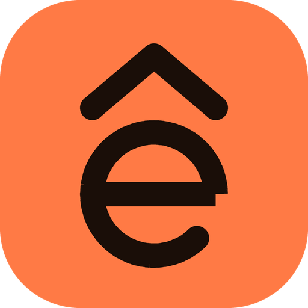

<p align="center">
  
</p>

<h1 align="center">Colaê</h1>

<p align="center">
  Tela, som e voz direto entre amigos — leve, gratuito e criptografado.<br>
  <sub>Screen sharing, audio and voice chat straight between friends (Windows, pt-BR).</sub>
</p>

---

O Colaê é um programa para Windows para **assistir junto e conversar**: alguém
cria uma sala, manda o convite, e quem entra pode transmitir a tela (com som),
assistir a transmissão dos outros, falar por voz e usar o chat.

A ideia é ser o contrário de pesado e de "passa tudo pelo servidor de alguém":

- **Direto entre vocês.** Tela, som e voz vão de um computador para o outro (P2P).
- **Criptografado de ponta a ponta.** Até o que passa pelo servidor (nomes,
  chat, fotos, prévias) vai trancado com uma chave que o servidor nunca vê.
- **Leve.** Um executável de ~8 MB, com interface que pesa pouco rodando.
- **Gratuito**, sem conta e sem cadastro.
- **Servidor seu, se quiser.** O servidor de sinalização é um arquivo Python
  sem dependências que qualquer um pode hospedar ([HOSPEDAR.md](HOSPEDAR.md)).

> Projeto pessoal, em desenvolvimento ativo (versão 0.8). Feedback e issues são
> muito bem-vindos.

## Recursos

- Salas de até **10 pessoas**, com convite por link (`colae://`) ou código.
- **Transmissão de tela** inteira ou de uma janela, com som do computador ou só
  da janela; qualidade de 480p a nativa, até 60 FPS; até **8 pessoas assistindo**
  cada transmissão. Codificação por hardware (NVIDIA, AMD ou Intel) quando
  disponível.
- Várias pessoas podem transmitir ao mesmo tempo; cada um escolhe quem assistir,
  com prévia de cada transmissão na sala.
- **Canal de voz** com redução de ruído (RNNoise), segurar para falar ou
  microfone aberto, atalhos globais (funcionam com o jogo aberto), volume por
  pessoa e indicador de quem está falando.
- **Chat** da sala, foto de perfil e nome da sala — tudo criptografado.
- Tema escuro e claro, barra de controles que some sozinha sobre o vídeo,
  painel lateral de pessoas e chat.

## Como usar

1. Baixe o `.zip` da versão mais recente em
   [Releases](https://github.com/Nikao1/stream-project/releases) e extraia.
   Mantenha o `Colae.exe` e o `ffmpeg.exe` na mesma pasta.
2. Abra o `Colae.exe`, escolha seu nome e clique em **Criar sala**.
3. Clique em **Copiar convite** e mande para os amigos. Quem clicar no link abre
   o Colaê direto na sala (ou cola o código na tela inicial).

O `LEIA-ME.txt` que vai no pacote explica cada parte com mais detalhes.

> O Windows pode mostrar o aviso "O Windows protegeu o computador" por o
> executável ainda não ter assinatura digital. Clique em **Mais informações →
> Executar assim mesmo**.

## Como funciona (resumo técnico)

```
 Pessoa A  ──────── tela, som e voz (UDP, cifrado) ────────  Pessoa B
     │                                                           │
     └──── só para se encontrarem (HTTPS) ──►  servidor  ◄───────┘
           IPs/portas + dados opacos ("e1.…")   de sinalização
```

- **Vídeo:** captura com Windows Graphics Capture / Direct3D 11, H.264 pelo
  `ffmpeg.exe` (NVENC, AMF, QSV ou x264), envio por UDP com recuperação de
  pacotes perdidos. Na ponta de quem assiste, decodificação e exibição com
  Direct3D 11.
- **Som e voz:** Opus; a voz é capturada a 16 kHz com cancelamento de eco do
  Windows, RNNoise e supressão de eco residual, e misturada por pessoa.
- **Conexão direta:** STUN + *hole punching* UDP. O servidor só troca os
  endereços entre as pessoas.
- **Criptografia:**
  - Mídia: troca de chaves X25519 por conexão, derivação com BLAKE2b e
    XChaCha20-Poly1305 por pacote (Monocypher).
  - Sala: o código tem a forma `ABCDEF-SEGREDO`; o segredo (8 caracteres) nunca
    sai dos computadores das pessoas. A chave da sala sai dele por
    **Argon2id** (16 MB, 3 passadas), e tudo o que passa pelo servidor vai
    trancado com XChaCha20-Poly1305.
- **Interface:** Dear ImGui sobre Direct3D 11.
- **Servidor de sinalização:** um único arquivo Python sem dependências
  (`signaling/signaling_server.py`), que guarda tudo só em memória.

Detalhes de privacidade em [PRIVACIDADE.md](PRIVACIDADE.md).

## Compilar

Requisitos: Windows 10/11, **Visual Studio 2022** (C++ para desktop) e
**CMake 3.20+**. As bibliotecas (ImGui, Opus, RNNoise, Monocypher) são
baixadas automaticamente pelo CMake.

```bat
cmake -S . -B build -G "Visual Studio 17 2022" -A x64
cmake --build build --config Release
```

O executável sai em `build\Release\Colae.exe`. Para rodar, coloque um
`ffmpeg.exe` na mesma pasta (por exemplo, de https://www.gyan.dev/ffmpeg/builds/).

Para montar o pacote de distribuição (`.zip` com o `.exe`, o `ffmpeg.exe` e o
LEIA-ME):

```bat
powershell -ExecutionPolicy Bypass -File tools\empacotar.ps1
```

### Servidor de sinalização

```bash
python signaling/signaling_server.py        # porta 8080
```

Qualquer pessoa pode **hospedar o próprio servidor** (Render gratuito, PC ou
Raspberry Pi em casa, ou Docker) e escolhê-lo em Configurações → Geral. O
convite leva o servidor junto, então só uma pessoa do grupo precisa hospedar.
Passo a passo em [HOSPEDAR.md](HOSPEDAR.md).

## Estrutura

| Pasta / arquivo | O que é |
|---|---|
| `src/receiver.cpp` | Programa principal: janela, salas, assistir, voz |
| `src/receiver_screens.cpp` | Telas da interface (início, sala, vídeo, configurações) |
| `src/main.cpp`, `src/client_*.cpp` | Modo transmitir (captura, codificação, envio) |
| `src/voice_*.cpp` | Canal de voz |
| `src/room_*.cpp`, `src/signaling_client.cpp` | Sala e conversa com o servidor |
| `src/stream_crypto.cpp`, `src/room_crypto.cpp` | Criptografia |
| `signaling/` | Servidor de sinalização (Python) |
| `tools/` | Empacotamento e LEIA-ME do pacote |

## Limitações conhecidas

- Só Windows 10/11 (64 bits).
- Em algumas combinações de rede (NAT simétrico, algumas operadoras com
  CGNAT), a conexão direta pode não acontecer — ainda não há um servidor de
  retransmissão como plano B.
- O servidor público roda em plano gratuito e pode demorar até 1 minuto para
  "acordar" na primeira conexão depois de um tempo parado.

## Licença

[MIT](LICENSE) — use, estude, modifique e distribua à vontade.

Componentes de terceiros e suas licenças estão em
[THIRD_PARTY_NOTICES.md](THIRD_PARTY_NOTICES.md). Uso do programa:
[TERMOS.md](TERMOS.md).
